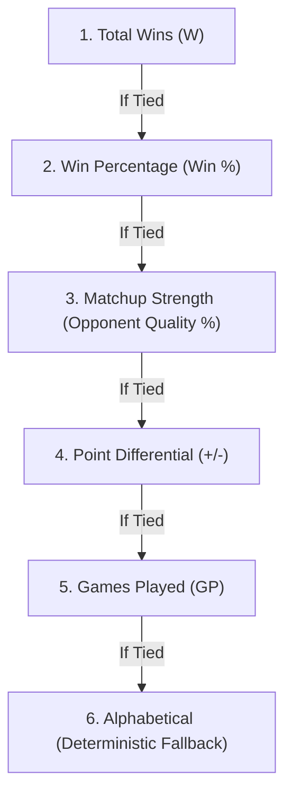

# Technical Design & Plausibility Assessment: Point Differential & Matchup Strength

## 1. Executive Summary & Objective

In recreational and competitive round-robin club play (badminton, pickleball, padel, etc.), players frequently finish a session with identical Win-Loss records (e.g., three players with 4–1 records).
Currently, PADQ's standings tables sort primarily by total wins (`b.wins - a.wins`) and win rate (`b.winRate - a.winRate`). When records are tied, there is no formal tie-breaking metric based on scoring margin or quality of competition.

This proposal introduces two complementary metrics into the session standings table across both singles and doubles:
1. **Point Differential ($\Delta P$ / `+/-`)**: Tally of net points scored minus points conceded in all scored matches.
2. **Matchup Strength (SoS / Opponent Quality)**: A normalized win-loss strength metric measuring the difficulty of opponents faced, enabling deterministic, merit-based tie-breakers across **both single-court and multi-court** sessions.

---

## 2. Plausibility & Feasibility Assessment

### A. Point Differential ($\Delta P$)
- **Data Availability**:
  - In single-court mode, `ScoreBoard` records match scores as `${sA} – ${sB}` (e.g. `"11 – 7"`, `"21 – 19"`), which is already persisted in `MatchHistoryEntry.score` in Firestore.
  - In multi-court mode (and un-scored single-court matches), scores are currently not prompted at court finish; matches finish via winner selection (`score` is `undefined`).
- **Plausibility Finding**:
  - **Highly Feasible**: Purely computational from existing `MatchHistoryEntry[]`. No database schema or Firestore security rules changes are required because `score` is already an allowed optional field in Firestore rules (`validHistory`).
  - **Graceful Handling of Un-scored Matches**: When a match does not have a recorded score (e.g., in multi-court rapid finish), it contributes $+0$ points scored and $+0$ points conceded. The player's point differential represents their net margin across all scored matches. If a player has played 0 scored matches, the table displays `—` or `+0`.

### B. Matchup Strength (Opponent Quality)
- **Data Availability**:
  - Every match in both single-court and multi-court sessions records `players` (e.g. `"Alice & Bob vs Charlie & Dave"` or `"Alice vs Bob"`) and `winner` (e.g. `"Alice & Bob"` or `"Alice"`).
- **Plausibility Finding**:
  - **100% Universally Available**: Because player rosters and winners are logged for every completed match across single-court and multi-court formats, Matchup Strength can be computed deterministically for **all** session modes without requiring score tracking.
  - **Solves the Multi-Court Tie-Breaking Gap**: While point differential is active when scoring is enabled, Matchup Strength acts as the primary tie-breaker in multi-court play where scoring is optional or rapid.

---

## 3. Mathematical Specifications

### Metric 1: Point Differential (`pointDiff` / `+/-`)

For each player $P$:
$$\Delta P = \sum_{m \in \text{ScoredMatches}(P)} \left( \text{PointsScored}(P, m) - \text{PointsConceded}(P, m) \right)$$

#### Score Parsing & Side Attribution Algorithm
Given a `MatchHistoryEntry`:
- Parse `entry.players`: split on `' vs '` to yield `SideA` and `SideB` (handling `&` for doubles partners).
- Parse `entry.score`: string pattern matching digits `(\d+)\s*[-–:]\s*(\d+)`.
  - In PADQ, `ScoreBoard` produces `${sA} – ${sB}` where `sA` corresponds to `SideA` and `sB` corresponds to `SideB`.
  - Cross-check with `entry.winner`:
    - If `entry.winner` matches `SideA`, then $S_A > S_B$.
    - If `entry.winner` matches `SideB`, then $S_B > S_A$.
- For each player $p \in \text{SideA}$:
  - Points For $\mathrel{+}= S_A$
  - Points Against $\mathrel{+}= S_B$
- For each player $p \in \text{SideB}$:
  - Points For $\mathrel{+}= S_B$
  - Points Against $\mathrel{+}= S_A$

---

### Metric 2: Matchup Strength (Strength of Schedule / Opponent Quality)

In sports standings (e.g., FIDE Buchholz, Swiss systems, American collegiate sports), there are two primary standard formulas for opponent strength:

#### Formulation 1: Opponent Win Percentage (Recommended Default)
Measures the average win rate of all unique opponents faced by player $P$:

$$\text{SoS}(P) = \frac{\sum_{O \in \text{Opponents}(P)} \text{Wins}(O)}{\sum_{O \in \text{Opponents}(P)} \text{GamesPlayed}(O)}$$

- **Doubles Distinction**: In doubles (`A & B vs C & D`), player `A`'s opponents in this match are `C` and `D`. Player `B` is a partner, not an opponent.
- **Normalization**: If a player's opponents have 0 games played outside the current match, or in early rounds, default is $50\%$.
- **Display**: Expressed as an integer percentage (e.g., `58%`) or ratio (`.583`).

#### Formulation 2: Opponent Net Wins / Total Wins (Alternative)
$$\text{OW}(P) = \sum_{O \in \text{Opponents}(P)} \text{Wins}(O)$$
- Directly counts total wins accumulated by opponents faced.
- Simpler integer display (`OW: 14`), but slightly biases toward players who faced opponents who played more total games.

> [!TIP]
> **Recommendation**: Use **Opponent Win Percentage** (`Opp Win %` or `SoS %`) because it is normalized and does not distort if some opponents played fewer or more games during the session.

---

## 4. Standings Tie-Breaking Hierarchy

The standings comparator across Host Analytics, Spectator Watch, and Recap Cards will follow this strict priority ladder:



1. **Wins (`b.wins - a.wins`)**: Primary ranking by total matches won.
2. **Win % (`b.winRate - a.winRate`)**: Rewards higher efficiency.
3. **Matchup Strength (`b.matchupStrength - a.matchupStrength`)**: Breaks ties by rewarding the player who faced harder competition (universal to single & multi-court).
4. **Point Differential (`b.pointDiff - a.pointDiff`)**: Secondary tie-breaker evaluating scoring margin in scored matches.
5. **Head-to-Head / Alphabetical**: Final deterministic tie-breaker.

---

## 5. UI & Layout Design

### Desktop Table View (Host Dashboard & Spectator View)

Current 8-column layout:
```text
# | Player | Rank | W | L | GP | Win % | Streak
```

Proposed 10-column layout:
```text
# | Player | Rank | W | L | GP | Win % | Diff | MS | Streak
```

- **`Diff` Column**:
  - Positive: `+12` (subtle emerald green `#22c55e`)
  - Zero: `0` (subtle slate muted `#94a3b8`)
  - Negative: `-6` (subtle rose coral `#f87171`)
  - No scored games: `—`
- **`MS` (Matchup Strength) Column**:
  - Displays as `58%` with tooltip `"Opponent Win %: 58% (Quality of competition)"`.

---

### Mobile Stacked Cards (Host Dashboard & Spectator View)

Current 4-column single row on mobile cards:
```text
[ #1 PlayerName ]          [ Gold ] [ 🔥3 ]
--------------------------------------------
W - L      GP        Win %      Streak
4 - 1      5         80%        3
```

Proposed 2-row x 3-column responsive grid on mobile cards:
```text
[ #1 PlayerName ]          [ Gold ] [ 🔥3 ]
--------------------------------------------
W - L      GP        Win %
4 - 1      5         80%
--------------------------------------------
Diff       Matchup   Streak
+14        58%       🔥3
```

- Clean, balanced visual hierarchy without horizontal scrolling.
- Preserves large tap targets and legible typography on mobile screens.

---

## 6. Implementation Architecture Plan (Once Approved)

1. **Data Model (`app/queue/lib/types.ts`)**:
   - Extend `PlayerStat`:
     ```ts
     export interface PlayerStat {
       name: string;
       wins: number;
       losses: number;
       gamesPlayed: number;
       winRate: number;
       streak: number;
       rank: RankTier;
       pointDiff: number;        // Net points (scored - conceded)
       pointsScored: number;     // Total points scored
       pointsConceded: number;   // Total points conceded
       scoredGames: number;      // Number of matches with recorded score
       matchupStrength: number;  // Opponents' combined win percentage (0-100)
     }
     ```
2. **Calculation Utility (`app/queue/lib/playerUtils.ts`)**:
   - Update `buildPlayerStats(players, history)`:
     - Pass 1: Compute basic W, L, GP, WinRate per player.
     - Pass 2: Calculate `pointDiff` via score parser.
     - Pass 3: Calculate `matchupStrength` by querying the Pass 1 records of opponents faced in each match.
   - Implement exported `comparePlayerStats(a, b)` for deterministic sorting across all views.
3. **Components & Layouts**:
   - `app/queue/components/AnalyticsDashboard/AnalyticsDashboard.tsx` (Host desktop table + mobile cards).
   - `app/watch/[sessionId]/page.tsx` (Spectator desktop table + mobile cards).
   - `app/queue/lib/recapUtils.ts` (Session Recap ranking consistency).
   - CSS styling in `QueueSystem.css` and `watch.css`.
4. **Unit & Scenario Tests (`tests/playerUtils.test.ts`, `tests/watchStandings.test.tsx`, `tests/analyticsDashboard.test.tsx`)**:
   - Verification of singles & doubles score parsing.
   - Verification of opponent mapping in doubles (opponents vs partner).
   - Verification of tie-breaker ladder resolution.
