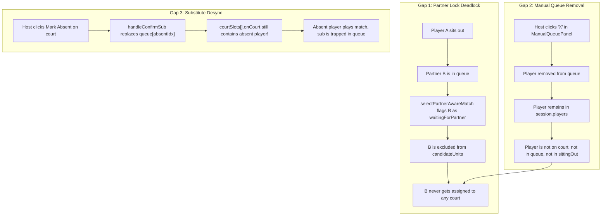
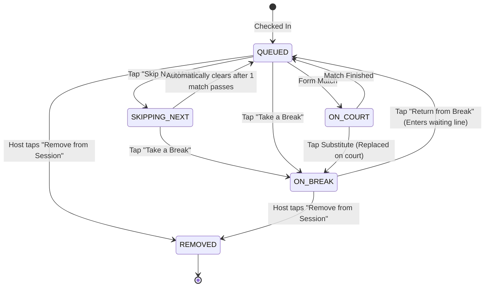

# PadQ V1: Implementation Plan — Queue, Sit-Out, Auto-Close & Phone UX

**Branch:** `matchup-differential`  
**Scope:** V1 only (Single-Court Doubles, Multi-Court Doubles, Singles King-of-the-Court, Singles Pool). Skilled Mode (`isSkilled`, `skillEngine.ts`, `skilledMatchmakingEngine.ts`) is strictly out of scope for V1 modifications.  
**Constraint:** Implementation plan specification document.

---

## 1. Executive Summary

During live court testing, four primary friction points were reported:
1. **Interface confusion on mobile phones** caused by an unranked wall of host buttons and exposed internal engine diagnostics.
2. **Post-match auto-close** implemented as an unpersisted checkbox inside a blocking modal dialog rather than an automatic notification.
3. **Players going "missing" during sit-outs**, caused by multi-court state blindness (benched players invisible to spectators and absent from screen layout), closure-stale queue mutations, origin-pool amnesia in single-court doubles, and locked-partner starvation.
4. **Lack of queue wait times**, leaving waiting players uncertain about their turn.

This implementation plan resolves all four concerns through a 6-phase incremental roadmap. It begins with an automated property test harness (Phase 0) that enforces the fundamental invariant:
$$\text{onCourt} + \text{queued} + \text{skipping} + \text{onBreak} \equiv \text{players.length}$$
It then introduces a dual-intent sit-out model (**"Skip Next Game"** vs **"Take a Break"**), replaces blocking result modals with a lightweight 3-second toast with Undo, restructures the phone interface into three clear zones with tap-to-inspect player bottom sheets, and deploys a deterministic match-count ETA (`Up in ~N matches`) while laying the data foundation for future continuous-time estimation.

---

## 2. Verified Findings

Every claim from the background report was audited line-by-line against the codebase:

| # | Claim | Verdict | Evidence (File & Line) | Technical Detail |
|---|---|---|---|---|
| **1** | No King-singles re-entry bug | **CONFIRMED** | `app/queue/page.tsx` L718-L753 | `isSittingOut` evaluates `activeSittingOut.includes(name)`. When `true`, the player is currently sitting out and toggling means *returning*. The `if (isSittingOut)` branch correctly invokes `addPlayerToSinglesWaiting`. The earlier research reversed the branch semantics. |
| **2** | Auto-close is an unpersisted checkbox in a modal | **CONFIRMED** | `app/queue/page.tsx` L203 `app/queue/components/WinnerModal/WinnerModal.tsx` L44-L47 | `autoClose` defaults to `useState(false)`. Rendered as `<input type="checkbox" checked={autoClose} />`. State resets on reload. |
| **3** | Multi-court with score uses toast; without score opens modal | **CONFIRMED** | `app/queue/page.tsx` L1291-L1297 `app/queue/page.tsx` L979-L985 | When `score` is truthy, `showToast` fires (3s auto-dismiss). When `score` is undefined (rapid winner tap), it falls back to `setModalOpen(true)`. |
| **4** | `SitOutPanel` is collapsed, host-only, hidden on `/watch` | **CONFIRMED** | `app/queue/components/SitOutPanel/SitOutPanel.tsx` L15 `app/queue/page.tsx` L2091 `app/watch/[sessionId]/LiveCourtStatus.tsx` L32-L34 | `SitOutPanel` initializes `open = false`. Wrapped in `{canControl && ...}` on host page. Neither `/watch` nor `LiveCourtStatus` renders `sittingOut`. Benched players vanish from viewer screens. |
| **5** | `addPlayerToWaiting` and `addPlayerToSinglesWaiting` silently no-op | **CONFIRMED** | `app/queue/lib/singleEngine.ts` L144-L148 `app/queue/lib/doublesEngine.ts` L416-L420 | Both functions inspect `includes(playerName)`. If state synchronization diverges between React queue and engine state, re-adding returns unchanged state with zero error or logging. |
| **6** | `handleToggleSitOut` uses stale `queue` closure | **CONFIRMED** | `app/queue/page.tsx` L723 | `newQueue = isSittingOut ? [...queue, name] : queue.filter(...)` captures `queue` from hook closure. `queueRef.current` exists at L192 but is ignored here. Rapid toggles overwrite each other. |
| **7** | Origin pool (winners vs losers) lost on doubles return | **CONFIRMED** | `app/queue/page.tsx` L756 `app/queue/lib/doublesEngine.ts` L421 | Sit-out removes from `w1`/`l1`/`waitingQueue`. Return always calls `addPlayerToWaiting`, placing the player into `waitingQueue`. Players cannot re-enter `w1` until the next cycle transition. |
| **8** | Mid-match sit-out behavior on `courtSlots[].onCourt` | **CONFIRMED (BUG)** | `app/queue/page.tsx` L717-L771 `app/queue/page.tsx` L1220-L1236 | `handleToggleSitOut` does **not** check or mutate `courtSlots`. If an active player sits out mid-game, they remain on court. When the court completes, `rotateMultiCourtDoubles` rotates them into `ranked`, potentially reassigning them immediately. |
| **9** | King sitting out (`king = null`) leaves engine stalled | **CONFIRMED (EDGE CASE)** | `app/queue/lib/singleEngine.ts` L70-L84 `app/queue/page.tsx` L2287 | When king sits out, `king` becomes `null`. `buildSinglesMatch` falls back to `queue[0] vs queue[1]`. If fewer than 2 active players remain in `queue`, `playerB` is `''`, stalling the cycle and corrupting `playedThisCycle`. |
| **10** | Queue structures differ across modes | **CONFIRMED** | `app/queue/lib/doublesEngine.ts` `app/queue/lib/singleEngine.ts` `app/queue/lib/singlesPoolEngine.ts` | Single-court doubles uses `PaddleState` (W1/L1 pools). Multi-court doubles uses a flat shared FIFO queue with partner pairing. Singles has King vs Pool variants. |
| **11** | File line endings are CRLF | **CONFIRMED** | Repo-wide `.gitattributes` & PowerShell test | Checked via `(Get-Content "app/queue/page.tsx" -Raw) -match "\r\n"`. Output: `True`. CRLF must be preserved. |

---

## 3. Gap Analysis: Additional "Missing Player" Paths

Beyond the verified findings, the codebase review exposed 4 additional paths where players disappear:

1. **Partner Lock Starvation Deadlock**: If Player A and Player B are locked partners, and Player A sits out, Player B remains in `queue`. In `doublesEngine.ts` L480, `selectPartnerAwareMatch` sees `playerSet.has(b) && !playerSet.has(a)` and adds Player B to `waitingForPartner`. The matching algorithm skips Player B indefinitely. Player B is technically queued but permanently unmatchable.
2. **`ManualQueuePanel` Orphan Path**: In `LiveManagement.tsx` L56-L59, clicking `X` calls `onRemove(i)`, which removes the player from `queue`. However, the player is **not** added to `sittingOut`, nor removed from `players`. They exist in `session.players` but have zero UI footprint anywhere on the page.
3. **Mid-Match Substitute Court Desync**: In `app/queue/page.tsx` L821-L867, `handleConfirmSub` swaps the absent player in `queue`, but fails to inspect or mutate `courtSlots`. If the absent player was currently on Court 1, Court 1 still lists the absent player! The replacement sits in the queue while the ghost player finishes the match.
4. **Firestore Strict Key Rejection**: `firestore.rules` L96-L98 explicitly enforces:
   `court.keys().hasOnly(['id', 'name', 'onCourt'])`.  
   If any client code saves a new field like `matchStartedAt` or `courtStatus` directly inside a court slot document without updating Firestore rules, Firebase rejects the write with a permission error, causing the optimistic UI to rollback and drop state.

---

## 4. Target Architecture: Dual-Intent Sit-Out Model

To eliminate confusion between temporary court rotation relief and extended absences, player availability is split into two distinct models:

### Concept 1: "Skip Next Match" (Ephemeral Relief)
- **Intent**: "I need a drink of water / let me catch my breath for one game."
- **Behavior**: The player retains their position in their queue pool (`w1`, `l1`, or multi-court FIFO bench). When the next match is generated, the selector skips them. Immediately after that match forms, the skip flag automatically expires.
- **Partner Rule**: If Player A is locked with Player B, skipping skips both partners together.

### Concept 2: "Take a Break" (Persistent Bench)
- **Intent**: "I have a phone call / bathroom break / eating."
- **Behavior**: The player is placed in `onBreak: string[]`. They do not participate in any matchmaking.
- **Visibility**: They are rendered in a dedicated, sticky **"On Break (N)"** section visible to both host and spectators.
- **Return**: A 1-tap "Return" button restores them to the active waiting queue.

---

## 5. Phased Implementation Plan

### Phase 0: Invariant Test Harness & Characterization Safety Net
*Must precede any functional or structural changes.*

- **Goal**: Establish automated verification of player preservation across every mode.
- **Files Touched**:
  - `tests/invariants/playerAccountability.test.ts` (New test file)
- **Data Model / Firestore**: None. Purely test infrastructure.
- **Behavior Tested**:
  Simulate 1,000 randomized state transitions (match completions, skips, breaks, returns, substitutions, additions) across:
  1. Single-court Doubles (Paddle Engine)
  2. Multi-court Doubles (FIFO Bench Engine)
  3. Singles King-of-the-Court
  4. Singles Pool Engine
  Assert invariant after every action:
  $$\text{onCourtPlayers} + \text{queuedPlayers} + \text{skippingPlayers} + \text{onBreakPlayers} \equiv \text{players.length}$$
- **Effort & Risk**: **S** (Small). Zero production risk.

---

### Phase 1: Core Bug Fixes & Mid-Match Sit-Out Hardening
*Fixes proven logic defects without altering UI layout.*

- **Goal**: Prevent stale state overwrites, eliminate King stall, and handle mid-match sit-outs safely.
- **Files Touched**:
  - `app/queue/page.tsx` (`handleToggleSitOut`, `handleConfirmSub`)
  - `app/queue/lib/singleEngine.ts` (`buildSinglesMatch`, `advanceSinglesState`)
  - `app/queue/lib/multiCourtResult.ts` (`planMultiCourtResult`)
- **Changes**:
  1. **Ref Consistency**: In `handleToggleSitOut`, calculate `newQueue` using `queueRef.current` rather than closure `queue`.
  2. **Mid-Match Sit-Out Guard**: If a player sitting out is currently in `courtSlots[].onCourt`:
     - Multi-court: Immediately trigger the substitution workflow or replace them with `waitingPlayers[0]`.
     - Single-court: Prompt host to declare winner or substitute before sitting out.
  3. **King Stall Defense**: In `singleEngine.ts`, if `king === null` and `queue.length < 2`, guard `buildSinglesMatch` to return `null` and provide a clean `isPaused` state rather than matching empty strings `''`.
  4. **Multi-Court Finisher Scrubbing**: In `multiCourtResult.ts`, filter `state.sittingOut` from `rotatedFinishers` so a player who sat out during the game is never re-queued on match completion.
- **Data Model / Firestore**: Backward compatible. Uses existing `sittingOut` and `courtSlots`.
- **Tests Added**:
  - Unit test: Sit out player who is actively on court in multi-court doubles. Verify they are removed from court and replaced.
  - Unit test: King sitting out with only 1 challenger in queue. Verify engine cleanly pauses without corrupting `playedThisCycle`.
- **Effort & Risk**: **M** (Medium). Low regression risk if covered by Phase 0 harness.

---

### Phase 2: Dual-Intent Sit-Out Engine & Shared Firestore Sync
*Delivers the "Skip Next Match" vs "Take a Break" capability.*

- **Goal**: Allow 1-game skips without losing queue priority, and keep "On Break" players visible to everyone.
- **Files Touched**:
  - `app/queue/lib/types.ts` (Extend `SessionDoc`)
  - `lib/sessionService.ts` (`SessionDoc`, `syncField`)
  - `app/queue/lib/doublesEngine.ts` (`buildNextMatch`, `selectPartnerAwareMatch`)
  - `app/queue/lib/singleEngine.ts` (`selectChallenger`)
  - `app/queue/page.tsx` (State synchronization)
  - `app/watch/[sessionId]/page.tsx` & `LiveCourtStatus.tsx`
- **Data Model & Firestore Schema**:
  - Add optional field to `SessionDoc`: `skipNext?: string[];` (Array of player names skipping their next game).
  - Note on Firestore Rules: `validSession` and `validSessionUpdate` in `firestore.rules` must be updated via the mandatory Firestore Rules specialist subagent to accept `skipNext`.
  - Backward compatibility: If `skipNext` is undefined in an active session, default to `[]`.
- **Engine Logic**:
  - `selectPartnerAwareMatch(rankedPlayers, lockedPairs, skipList)`: Filter `skipList` from candidates *before* selecting the match.
  - In `advancePaddleState` and `rotateMultiCourtDoubles`: After match selection is confirmed, remove the selected match's skipped players from `skipNext` (one-shot consumption).
  - Partner Rule: If Player A is in `skipNext` and locked with Player B, add Player B to effective `skipList`.
- **Tests Added**:
  - Unit test: Player with `skipNext` is bypassed for 1 match, then automatically selected on the subsequent match.
  - Unit test: Locked pair skips together.
  - Unit test: Starvation prevention — if skipping leaves fewer than 4 players, skip is cancelled with user notice.
- **Effort & Risk**: **M** (Medium). Requires Firestore rules coordination.

---

### Phase 3: Match Completion Feedback Unification
*Eliminates the auto-close checkbox and unifies all match completion flows.*

- **Goal**: Make match closing 100% automatic, non-blocking, and consistent across single and multi-court.
- **Files Touched**:
  - `app/queue/components/WinnerModal/WinnerModal.tsx`
  - `app/queue/page.tsx` (`handleCourtMatch`, `handleSinglesMatch`, `handleDoublesMatch`)
  - `app/queue/QueueSystem.css`
- **Changes**:
  1. **Toast for All Normal Matches**: Remove `WinnerModal` invocation from regular match completion. All match results (scored or unscored, single or multi-court) render an enhanced toast:
     `"Court 1: Alice & Bob won (11–7) · [Undo]"`
  2. **Toast Interaction**:
     - Auto-dismisses in exactly 3.0s.
     - Tapping or hovering anywhere on the toast pauses the timer.
     - Includes an inline `Undo` button wired directly to `handleUndoLastMatch`.
  3. **WinnerModal Scope Reduction**: Retain `WinnerModal` *only* for tournament finals (`activeTournamentWinner`) or session championships. Remove the `autoClose` checkbox entirely; in its place, render a circular SVG countdown ring that auto-closes in 3s unless clicked.
- **Data Model / Firestore**: None. Client UI change only.
- **Tests Added**:
  - Component test: Rapid match completion produces non-blocking toast.
  - Component test: Toast Undo triggers rollback.
- **Effort & Risk**: **S** (Small). Low risk, immediate UX improvement.

---

### Phase 4: Phone-First Visual Hierarchy & Progressive Disclosure
*Solves interface confusion on mobile screens.*

- **Goal**: Create a clean, uncrowded mobile UI with 3 primary zones and 44px tap targets.
- **Files Touched**:
  - `app/queue/components/atoms/PlayerLabel.tsx`
  - `app/queue/page.tsx`
  - `app/queue/components/SitOutPanel/` (Decomposed into On-Break strip)
  - `app/queue/components/PlayerBottomSheet/` (New component)
  - `app/queue/QueueSystem.css`
- **Changes**:
  1. **Three Visual Zones (Host & Spectator)**:
     - **Zone 1: Active Courts** (Top) — Clean CourtCards with Team containers.
     - **Zone 2: Waiting Queue** (Middle) — Vertical list with position chips `#1`, `#2`.
     - **Zone 3: On Break Strip** (Bottom) — Dedicated collapsible section:
       `"On Break (2): Charlie, Dave [Return All]"` with 1-tap `Return` pills.
  2. **Player Chip Bottom Sheet**:
     - Tapping any player chip opens a native-feeling mobile bottom sheet with clear actions:
       - ⚡ *Skip Next Match*
       - ☕ *Take a Break*
       - 🔄 *Swap with Player...*
       - ❌ *Remove from Session* (Host only)
  3. **Visual Status Badges**:
     - Status pills on every chip: `🟢 Playing`, `🟡 On Deck`, `⚪ Waiting #N`, `⏳ Skipping 1`, `☕ On Break`. Text + color for accessibility.
  4. **Host Controls Drawer**:
     - Move secondary controls (`ManualQueuePanel`, `PartnerPanel`, `Score Toggle`) into a single collapsible "Host Tools" drawer.
     - Hide internal engine diagnostics (`PaddleStatusPanel`, `PoolSinglesStatusPanel`) behind an explicit "Diagnostics" toggle.
  5. **Clear Score Toggle Label**:
     - Replace ambiguous button with explicit segmented pill:
       `Record Mode: [ Quick Winner | Enter Score ]`.
- **Data Model / Firestore**: None.
- **Tests Added**:
  - Browser tests on 375px viewport (iPhone SE): Verify all tap targets are $\ge 44\text{px}$, zero horizontal overflow.
- **Effort & Risk**: **M** (Medium). High visual impact.

---

### Phase 5: Waiting Queue Wait-Time ETA (Phase 1 Engine)
*Delivers deterministic match-count ETA to players in queue.*

- **Goal**: Give queued players clear visibility into when they will play.
- **Files Touched**:
  - `app/queue/lib/etaEngine.ts` (New utility)
  - `app/queue/components/atoms/PlayerLabel.tsx`
  - `app/watch/[sessionId]/LiveCourtStatus.tsx`
  - `app/queue/page.tsx`
- **Algorithm (V1 Deterministic Batch Formula)**:
  For a player at 1-based queue index $k$ among eligible waiting players (excluding `onBreak` and `skipping`):
  $$\text{Matches Ahead} = \left\lceil \frac{k}{C \times S} \right\rceil$$
  Where $C = \text{active courts}$, $S = \text{players per court}$ ($4$ for doubles, $2$ for singles).
  - Display badge:
    - $k \le C \times S$: `Next match!` (Amber highlight)
    - Otherwise: `Up in ~N matches`
- **Phase 2 Readiness Hook (No UI yet)**:
  - Add `matchStartedAt: number` to local `CourtSlot` tracking in memory.
  - Log match durations in browser telemetry to calibrate the future continuous EMA ($\alpha = 0.2$) model.
- **Data Model / Firestore**:
  - Keep `matchStartedAt` local-only in V1 to avoid Firestore schema conflicts until rules are upgraded in Phase 2.
- **Tests Added**:
  - Unit tests in `etaEngine.test.ts`: Verify calculation with 1, 2, 3 courts; doubles (S=4) and singles (S=2); skipping players bypassed.
- **Effort & Risk**: **S** (Small). Zero data corruption risk.

---

## 6. Property-Based Test Strategy (Phase 0)

To guarantee that no state transition can drop a player, a simulation test harness (`tests/invariants/playerAccountability.test.ts`) will be implemented using Vitest.

### Invariant Equations
1. **Total Roster Conservation**:
   $$\forall s \in \text{States}: \quad |\text{onCourt}(s)| + |\text{queue}(s)| + |\text{onBreak}(s)| = |\text{players}|$$
2. **Mutual Exclusion**:
   $$\text{onCourt}(s) \cap \text{queue}(s) = \emptyset, \quad \text{onCourt}(s) \cap \text{onBreak}(s) = \emptyset, \quad \text{queue}(s) \cap \text{onBreak}(s) = \emptyset$$
3. **No Ghost Finishers**:
   $$\text{finishedPlayers} \subseteq \text{players}$$

### Random Walk Generator Configuration
- **Roster**: 8 to 24 players.
- **Courts**: 1, 2, and 3 courts.
- **Modes**: Single-court Doubles, Multi-court Doubles, Singles King, Singles Pool.
- **Steps**: 200 random actions per run:
  - `WIN_MATCH` (random winning side)
  - `SKIP_NEXT` (random queued player)
  - `TAKE_BREAK` (random active or queued player)
  - `RETURN_BREAK` (random resting player)
  - `SUBSTITUTE` (mid-match replacement)
  - `ADD_PLAYER` (dynamic mid-session registration)
- **Assertion**: Evaluated synchronously after every step. Any invariant violation dumps the reproduction seed and action log.

---

## 7. Open Decisions & Recommended Defaults

| # | Question | Options | Recommended Default | Rationale |
|---|---|---|---|---|
| **1** | How should locked partner pairs behave when one partner skips? | A: Break pair B: Skip pair together C: Disallow skip | **B: Skip pair together** | Preserves the integrity of the locked pair contract without stranding the other partner in deadlock. |
| **2** | What happens if skips reduce eligible waiting players below court capacity? | A: Cancel skips with alert B: Leave court idle | **A: Cancel skips with alert** | Courts should never sit empty during recreational club nights when players are present. |
| **3** | Where should `matchStartedAt` be stored in V1? | A: In Firestore `CourtSlot` B: In client memory only | **B: In client memory only** | `firestore.rules` enforces `court.keys().hasOnly(['id', 'name', 'onCourt'])`. Storing in memory avoids premature rules deployment while still capturing calibration telemetry. |
| **4** | What should happen if a King sits out in singles? | A: Next 2 in queue play for empty crown B: Highest win-streak takes crown | **A: Next 2 in queue play** | Standard open-play King of the Court rule. Prevents arbitrary assignment. |
| **5** | Should "On Break" players retain their original queue position when they return? | A: Append to back of queue B: Restore original position | **A: Append to back of queue** | Returning to the front penalizes players who waited. "Skip Next" handles keeping priority; "Take a Break" goes to the back. |

---

## 8. Mobile Acceptance Criteria (Phone Verification)

These criteria can be verified directly on an iPhone / Android mobile browser:

### Concern 1: Mobile Interface Clarity
- [ ] On a 375px mobile viewport, the host screen shows 3 distinct vertical zones: Active Courts, Waiting Queue, and On Break strip.
- [ ] No button or touch target is smaller than $44 \times 44\text{px}$.
- [ ] Internal engine pools (`w1`, `l1`, `playedThisCycle`) are hidden by default and accessible only under an explicit "Diagnostics" toggle.
- [ ] The score entry toggle clearly indicates current state (`[ Quick Winner ]` vs `[ Enter Score ]`).

### Concern 2: Match Auto-Close
- [ ] Completing a match on any court (with or without score) closes immediately with zero blocking dialogs.
- [ ] A non-blocking toast appears at the top/bottom: `"Court 1: Team 1 won · [Undo]"`.
- [ ] The toast auto-dismisses after 3 seconds.
- [ ] Tapping the toast pauses dismissal. Tapping `Undo` cleanly rolls back the match and restores the court.

### Concern 3: Sit-Out & Absence Integrity
- [ ] Tapping a player chip opens a bottom sheet with *"Skip Next Match"* and *"Take a Break"*.
- [ ] Tapping *"Skip Next Match"* marks the chip as `⏳ Skipping 1`. When the next court match forms, that player is passed over, and the badge automatically clears.
- [ ] Tapping *"Take a Break"* moves the player to the visible *"On Break (N)"* strip.
- [ ] Spectators on `/watch/[sessionId]` clearly see the *"On Break"* list; no player disappears from total count.
- [ ] Tapping *"Return"* on an on-break player places them at the back of the waiting queue.
- [ ] Total player count on screen always equals `onCourt + queued + onBreak`.

### Concern 4: Queue Wait-Time ETA
- [ ] Every waiting player chip displays a legible badge: `Next match!` (for the imminent group) or `Up in ~N matches`.
- [ ] As courts complete matches, `N` decrements in real time across both host and spectator views.
- [ ] Players on break are excluded from the queue countdown.
