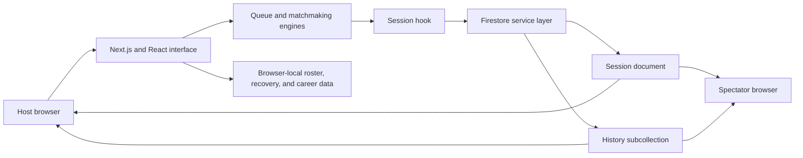

# PAD-Q

<p align="center">
  
</p>

**Real-time queue and matchmaking software for singles and doubles play.** PAD-Q helps a host organize players, rotate matches across one or more courts, record results, and share a live spectator view without requiring viewers to install an application.

[Live demo](https://pad-q.vercel.app) · [GitHub repository](https://github.com/Sceyo/PadQ)

## Project status

PAD-Q is an independently developed product in **active development**. The `main` branch contains the production V1 release baseline; active feature development for V1.2 is underway on `Matchmaking-skill-based`.

- Production baseline: **`v1.0.0-rc.6`**
- Deployed on Vercel with Firebase Cloud Firestore and Firebase App Check enforcement
- **257 application unit & scenario tests** passing across 22 test files
- **34 Firestore Emulator security & concurrency tests** passing (0 failures)
- Standings upgraded with **Point Differential (`+/-`)** and **Matchup Strength (`OWP` — Opponent Win Percentage)** deterministic tiebreaks
- Active feature branch: **`Matchmaking-skill-based`** (reviving V1.2 Skill-Aware Matchmaking)
- Zero production runtime vulnerabilities (`npm audit --omit=dev`)
- Protected `main` branch with a required GitHub Actions quality gate

The V1.0 candidate is deployed and has passed the clean CI, production build, security-rule, 30-viewer, and three-court concurrency gates. Final public testing validation is underway per [Gate 8](docs/v1/V1-PUBLIC-RELEASE-TASKS.md#8-final-task--open-public-testing-validation-gate). All architectural and operational documentation is indexed in [`docs/README.md`](docs/README.md).

### V1 operating contract

- Up to **30 players**, **3 courts**, and **30 simultaneous Live Watch viewers**
- One host device and one anonymous session owner
- Temporary event rooms rather than permanent venue or player accounts
- Firebase Spark and Vercel Hobby operation with a **$0 / ₱0 infrastructure target**
- Online-first operation with safe manual retry after a failed result submission

## The problem

Running a club night or casual sports session becomes difficult when one person has to manually remember:

- who has waited the longest;
- which players or teams have already met;
- who should rotate after a win or loss;
- how to distribute players across several courts;
- which players are sitting out or temporarily absent; and
- how to keep waiting players and spectators informed.

PAD-Q turns those decisions into a shared, real-time workflow. The host manages the session from one browser, while viewers follow current court assignments, the queue, completed results, history, and statistics through a room code or shared link. Single-court sessions can also share a live score.

## Key features

### Session management

- Singles and doubles session setup
- Six-character room codes, direct watch links, and QR sharing
- Explicit **Go Live** control before a session is shown to viewers
- Automatic same-browser host recovery through Firebase Anonymous Authentication
- Responsive light and dark interfaces

### Match and court operations

- Default singles and doubles queue rotation
- Shared multi-court assignment for one to three courts
- Shared multi-court rotation that avoids immediate unlocked-partner repeats, with optional permanent partner pairs
- Optional point-by-point live scoring for single-court sessions; winner-only results for multi-court sessions
- Player sit-out, return, substitution, and “sit next” controls
- Single-step undo for supported match flows
- Score correction, duplicate-submit protection, failed-save rollback, and refresh persistence
- Saved club roster for faster future setup

### History and analytics

- Timestamped match results and optional scores
- Deterministic 4-level standings hierarchy: **Wins $\to$ Win Rate $\to$ Point Differential (`+/-`) $\to$ Matchup Strength (`OWP`)**
- Session win/loss records, point differentials, opponent win percentages, streaks, and rank tiers
- Host session leaderboards and deep performance statistics
- Device-local career statistics
- Spectator match history, court-by-court results, and next-match announcements

## Product preview

### Session entry


The homepage gives players and organizers direct access to singles, doubles, and spectator experiences.

### Shared multi-court matchmaking


The V1 launch flow prioritizes a clear shared waiting queue, fair court assignment, sit-out handling, and optional permanent partner pairs.

### Host scoring


In a single-court session, the host can enable point-by-point scoring, select a target score, update either team, and record the winner from the same match view. Multi-court V1 uses winner-only results so one host can manage up to three courts efficiently.

### Live spectator view


For a single court, spectators can follow the optional live score. In
multi-court sessions, **Live Court Status** lets a viewer choose Court 1, 2, or
3 and see its current players, together with the shared next-player queue,
without requiring the host to enter every point.

During a live multi-court doubles session, the host can set up to
`floor(players / 2)` optional partner pairs. Pair changes apply on the players'
next shared court assignment. New pairs must currently be together on one court
or together in the waiting queue, so an active match is never interrupted. The
editor stages all changes locally and sends one Firestore update when saved.

### Multi-court management


Multi-court sessions keep active matches visible together so a host can record results and continue player rotation across three courts.

Explore the current build through the [live demo](https://pad-q.vercel.app).

## My role and ownership

PAD-Q is an independent product that I own and develop as **Founder & Full-Stack Developer**. I designed and implemented the product experience, frontend architecture, queue and matchmaking engines, Firestore integration, automated tests, and deployment workflow.

Development has included feedback and code review from other people, along with AI-assisted review and development using Codex and Claude Code. Product ownership and final implementation decisions remain mine.

## Architecture

PAD-Q is a client-heavy Next.js application. Domain logic is kept in TypeScript queue engines, while a session hook and service layer coordinate shared Firestore state.



### Data flow

1. A host action is validated and translated into a queue-engine transition.
2. The resulting session state is sent through `useSession` and `lib/sessionService.ts`.
3. Firestore stores shared state in `sessions/{sessionId}` and results in its `history` subcollection.
4. Real-time `onSnapshot` listeners update connected host and spectator browsers.
5. A completed match uses a revision-checked Firestore transaction so the session update and idempotent history entry commit together without lost updates.

There is no separate REST or GraphQL backend in this repository. The browser uses the Firebase SDK directly, making Firestore rules the effective authorization boundary.

## Technology stack

| Area | Technology | Use in PAD-Q |
|---|---|---|
| Framework | Next.js 16.3.1, App Router | Routing and application structure |
| UI | React 19.2.4 | Interactive host and spectator experiences |
| Language | TypeScript 5 | Typed application and matchmaking logic |
| Data | Firebase 12.17.1 / Cloud Firestore | Persistence and real-time synchronization |
| Testing | Vitest 4.1.9 | Unit and simulation tests |
| Styling | Custom CSS, CSS Modules, Tailwind CSS 4 | Responsive interface and theme styling |
| Supporting UI | Lucide React, `qrcode.react` | Icons and session QR codes |
| Deployment | Vercel | Hosted Next.js application |

## V1 matchmaking and rotation

### Default

- **Singles:** king-of-the-court rotation. A winner remains king until defeated or until reaching the three-win rotation limit.
- **Doubles:** an `INIT → WINNERS → LOSERS` state machine seeds the player pool and alternates between winner and loser groups.
- Candidate doubles teams are scored to reduce repeated partners, repeated matchups, immediate replay, and skill imbalance.

### V1.2 Active Development: Skill-Aware Matchmaking

Skill-based matchmaking is being revived and modernized for **V1.2** on the `Matchmaking-skill-based` branch (see [`docs/v1.2/SKILL_AWARE_MATCHMAKING.md`](docs/v1.2/SKILL_AWARE_MATCHMAKING.md)).

The skill engine groups players as **Beginner**, **Intermediate**, or **Advanced**. Court allocation follows a strict priority cascade:

1. **P1 (Pure Match):** Four players from the exact same skill bracket.
2. **P2 (Majority + Adjacent):** Majority bracket filled by immediate neighbor (B+I or I+A; never B+A).
3. **P3 (Split Fill):** Adjacent brackets split 2+2 or 3+1.
4. **P3B (Cross-Bracket Snake):** When no intermediates exist, allow B+A with snake drafting (`Team A: B1 + A2`, `Team B: B2 + A1`).

Wait-cycle counters provide a **starvation override** so a smaller skill group is not skipped indefinitely. In V1.2, court assignments project directly into `courtSlots` so spectators follow live skill-bracket matches in real-time.

Tournament, Play-All, viewer PIN setup, and the legacy independent-court coordinator remain sealed on `all-features-archive` for subsequent releases.

## Testing and quality assurance

The automated test suite includes:

- **257 passing application unit, simulation, scenario, and component tests** across 22 test files;
- **34 passing Firestore Emulator security and concurrency tests**; and
- **16 passing browser end-to-end and stress scenarios**.

The suite focuses on deterministic domain logic and verifies:

- singles king, challenger, fatigue, and forced-rotation behavior;
- doubles phase transitions, partner selection, pool limits, and serialization;
- point differential calculations, doubles opponent win percentages (OWP), and deterministic tiebreak rankings;
- skill-priority selection, snake-draft ordering, rest cycles, starvation prevention, and idle-court filling;
- prototype pollution hardening and linear regex ReDoS resistance; and
- 25- and 30-player rush scenarios, three-court concurrent completion, queue
  removal, score recovery, reconnects, and 30 simultaneous Live Watch viewers.

The simulations check important invariants, including preventing a player from occupying two courts, keeping every player accounted for, bounding player-pool sizes, and ensuring waiting players eventually receive matches.

The repository includes Firestore Emulator rule tests, focused React component
tests for Live Court Status, and browser end-to-end tests against local
Authentication and Firestore emulators. GitHub Actions runs lint, the unit and
scenario suite, the production build, Firestore rules tests, browser/stress
tests, and a production dependency audit. This strict `verify` check is required
before protected `main` can accept a pull request. ESLint has no errors; existing
warnings remain tracked as non-blocking development limitations.

The detailed persona assessment is recorded in
[`V1-PERSONA-ACCEPTANCE-MATRIX.md`](docs/v1/V1-PERSONA-ACCEPTANCE-MATRIX.md).

## Local setup

### Prerequisites

- Node.js 20 or a compatible current LTS release
- npm
- A Firebase project with a Firestore database

### 1. Clone the repository

```bash
git clone https://github.com/Sceyo/PadQ.git
cd PadQ
```

### 2. Install dependencies

```bash
npm install
```

### 3. Configure Firebase

Create a Firebase project, enable Cloud Firestore, enable the **Anonymous** sign-in provider in Firebase Authentication, and register a web application. Add every production and local hostname to the Firebase API key's allowed HTTP referrers. Create `.env.local` in the repository root using placeholder values like these:

```dotenv
NEXT_PUBLIC_FIREBASE_API_KEY=your_firebase_api_key
NEXT_PUBLIC_FIREBASE_AUTH_DOMAIN=your-project-id.firebaseapp.com
NEXT_PUBLIC_FIREBASE_PROJECT_ID=your-project-id
NEXT_PUBLIC_FIREBASE_STORAGE_BUCKET=your-project-id.appspot.com
NEXT_PUBLIC_FIREBASE_MESSAGING_SENDER_ID=your_messaging_sender_id
NEXT_PUBLIC_FIREBASE_APP_ID=your_firebase_app_id
NEXT_PUBLIC_FIREBASE_APP_CHECK_ENABLED=false
NEXT_PUBLIC_FIREBASE_APP_CHECK_SITE_KEY=your_recaptcha_enterprise_site_key
```

Do not commit `.env.local` or paste real project configuration into issues, screenshots, or documentation.

For production, register the web app with Firebase App Check using reCAPTCHA
Enterprise, add the site key in Vercel, then set
`NEXT_PUBLIC_FIREBASE_APP_CHECK_ENABLED=true`. Monitor verified requests before
enabling Firestore enforcement in Firebase Console. Keep the switch false for
unregistered local and preview environments.

Deploy the repository's Firestore rules and indexes to your selected Firebase project:

```bash
npx -y firebase-tools@latest deploy --only firestore:rules,firestore:indexes
```

Review `firestore.rules` and run `npm run test:rules` before using a project that contains real or sensitive data. The rules suite requires Java 21 or newer for the local Firestore emulator.

### 4. Start the development server

```bash
npm run dev
```

Open [http://localhost:3000](http://localhost:3000).

### Safe local Firebase browser testing

Use two PowerShell terminals so browser tests cannot write to production.

Terminal 1:

```powershell
npm.cmd run emulators
```

Terminal 2:

```powershell
$env:NEXT_PUBLIC_USE_FIREBASE_EMULATORS="true"
npm.cmd run dev
```

Set the switch before starting Next.js. If the development server was already
running, stop and restart it. The local Emulator UI is available at
[http://127.0.0.1:4000](http://127.0.0.1:4000).

## Available commands

| Command | Purpose |
|---|---|
| `npm run dev` | Start the Next.js development server |
| `npm run emulators` | Start local Authentication and Firestore for safe browser tests |
| `npm run build` | Create a production build |
| `npm run start` | Serve the production build |
| `npm run lint` | Run ESLint |
| `npm test` | Run the Vitest suite once |
| `npm run test:rules` | Run Firestore security and concurrency tests in the emulator |
| `npm run test:e2e` | Run the full browser and stress suite against local emulators |
| `npx tsc --noEmit --incremental false` | Run a standalone TypeScript check without emitting files |

## Deployment

The authoritative public-release register is
[`V1-PUBLIC-RELEASE-TASKS.md`](docs/v1/V1-PUBLIC-RELEASE-TASKS.md). RC6 has completed
the automated, security, capacity, clean-CI, merge, tag, and production
deployment work. The final go/no-go activity is the supervised event described
in [`V1-SUPERVISED-EVENT-RUNBOOK.md`](docs/v1/V1-SUPERVISED-EVENT-RUNBOOK.md). The
planned scope after launch, including multi-host sessions and V1.2 features, is maintained in
[`PADQ-RELEASE-ROADMAP.md`](docs/PADQ-RELEASE-ROADMAP.md) and [`docs/README.md`](docs/README.md).

The live application is hosted on Vercel at [pad-q.vercel.app](https://pad-q.vercel.app).
A production deployment requires the six Firebase web configuration variables
plus `NEXT_PUBLIC_FIREBASE_APP_CHECK_ENABLED` and
`NEXT_PUBLIC_FIREBASE_APP_CHECK_SITE_KEY`. Preview and local environments should
leave App Check disabled unless their hostnames are separately registered.

Firestore is managed separately:

- `firebase.json` selects the default Firestore database in `asia-southeast1`.
- `firestore.rules` contains database access rules.
- `firestore.indexes.json` currently defines no composite indexes.

The code updates a `lastActiveAt` server timestamp during host activity and detects when a session document disappears. Automatic expiry is **not currently confirmed as enabled**. Firestore TTL expects a TTL field to represent an expiration time, and deletion is not immediate. A correct expiry design and deployed TTL policy remain planned work.

## Known limitations

- **Single host:** V1 has one anonymous session owner. Multi-host management, delegated referees, and safe cross-device ownership transfer are deferred.
- **No guaranteed 30-minute expiry:** activity timestamps exist, but an appropriate expiration timestamp and confirmed deployed TTL policy do not.
- **Browser-local data:** saved rosters, skill assignments, court groups, recovery data, and career statistics are device-specific.
- **Online-first behavior:** a failed authoritative result safely restores the previous state and can be retried manually, but V1 has no durable automatic offline replay queue.
- **Multi-court scoring:** V1 shares current players and completed results, but intentionally does not synchronize point-by-point scores for multiple courts.
- **Viewer and court ceiling:** the tested free-tier contract is 30 viewers and 3 courts. PAD-Q does not promise 300-viewer events or four or more courts in V1.
- **No ETA or competitive rating:** Live Watch shows current courts and next players, but not an estimated wait. Bronze–Diamond tiers summarize session win rate and are not Elo, DUPR, or opponent-adjusted ratings.
- **No permanent venue or player accounts:** V1 rooms are temporary, and PAD-Q does not claim certified GDPR compliance or provide cloud player-profile requests.
- **Partial test boundary:** automated browser coverage includes core host, viewer, capacity, reconnect, score recovery, and scope-seal journeys; the supervised real event remains the final human-use gate.
- **Open quality findings:** the test suite and build pass; linting still reports warnings.
- **Large controllers:** the main host and spectator pages still contain substantial orchestration logic and would benefit from further decomposition.

## Planned improvements

1. Add secure multi-host roles, delegated court scoring, and cross-device ownership recovery.
2. Add a compact spectator projection and high-fan-out realtime delivery for events beyond 30 viewers.
3. Implement a durable offline result outbox with automatic replay and clearer synchronization status.
4. Implement an explicit `expireAt` strategy and enable a verified Firestore TTL policy.
5. Add persistent venues and optional player accounts with appropriate privacy and deletion controls.
6. Add measured wait estimates only after PAD-Q can collect reliable match-duration data.
7. Add opponent-aware competitive ratings and tournament rules as separately validated modes.
8. Add CSV history export, roster import, stat-card sharing, and configurable rotation policies.
9. Further decompose the host and spectator controllers and resolve remaining lint warnings.

## Usage notice

Copyright © 2026 Francis Aliser. All rights reserved.

PADQ is proprietary software. This repository is publicly visible for review, evaluation, and portfolio purposes. No permission is granted to use, copy, modify, redistribute, sublicense, host, commercially exploit, or create derivative works from the source code or product assets without prior written permission from the copyright holder.

See the [proprietary software notice](LICENSE) for the complete terms. PADQ is not open-source software.

## Author and contact

- **Created and maintained by Francis Aliser**
- [GitHub](https://github.com/Sceyo)
- [LinkedIn](https://www.linkedin.com/in/francis-aliser/)
- [Portfolio](https://aliser-portfolio.vercel.app/)
